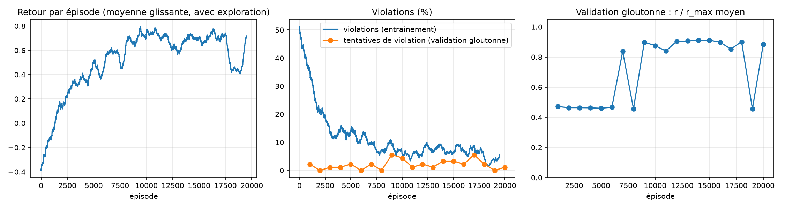

## Machine-learning tools for designing **multi-ring circular antenna arrays** (5 rings, 0–10 elements per ring, 2.45 GHz), plus revision notes on op-amp circuits (bistables, monostables, astables).

The repository contains three independent parts:

| Part | Approach | Question it answers |
|---|---|---|
| [cGAN](#1-cgan--inverse-design) | Conditional GAN (PyTorch) | Given target specs, *how many elements* should each ring have? |
| [SARSA v1 — thinning](#2-sarsa-v1--array-thinning-sarsa) (`SARSA/`) | Tabular SARSA | How many elements can be *switched off* while keeping performance within tolerance? |
| [SARSA v3 — SSL minimisation](#3-sarsa-v3--ssl-minimisation-root-folder) | Tabular SARSA | Which elements should be switched off/on to *minimise the side-lobe level* under gain and beamwidth constraints? |
| [Course notes](#4-electronics-course-notes) | — | Op-amps in non-linear mode |

All code and documentation are written in French.

---

## Physical model

The three ML projects share the same array-factor model:

- Frequency: 2.45 GHz, first ring radius `r0 = 0.2λ`, ring spacing `Δr = 0.5λ`
- 5 concentric rings, 0 to 10 isotropic elements per ring, steering angle θ0 ∈ [0°, 180°]
- Metrics computed from the 2D radiation pattern:
  - **Gmax** (dB): main-lobe gain, `20·log10(N_total)` at θ0
  - **SSL** (dB): side-lobe level, the highest secondary lobe
  - **HPBW** (°): half-power beamwidth
  - **θ0** (°): main-lobe direction

The datasets are generated with seed `46`, so the cGAN and SARSA v1 pipelines produce identical `Minput` / `Moutput` matrices and the same test set.

| Matrix | Shape | Content |
|---|---|---|
| `Minput` | 4 × N | `[Gmax ; SSL ; HPBW ; θ0]` |
| `Moutput` | 5 × N | number of elements in rings 1 to 5 |

---

## 1. cGAN — inverse design

The inverse problem is one-to-many: several architectures can meet the same specification. A conditional GAN learns this distribution instead of a single answer.

- **Generator** `G([z | c]) → x̂ ∈ [0,1]⁵`: noise `z` (dim 16) plus specs `c`, mapped to normalised element counts
- **Discriminator** `D([x | c]) → logit`
- BCE loss (non-saturating for G), one-sided label smoothing (0.9), dequantisation noise on real samples
- Optional auxiliary loss linking Gmax to the total number of elements: `L_N = (ΣN̂ − 10^(Gmax/20))²`
- Hidden layers `(128, 128, 64)` for both networks, Adam (`lr = 2e-4`, `β = (0.5, 0.999)`), batch 64, 2000 epochs

At test time, G generates K candidates per specification. Each candidate is rounded to integers, re-evaluated with the physical model and scored with MAE, relative error and a weighted global error. The script reports both the first candidate (comparable to a feed-forward network) and the best of K.

### Pipeline

| Step | Script | Output |
|---|---|---|
| 1 | `dataset.py` | `Minput.npy/.mat`, `Moutput.npy/.mat` |
| 2 | `repartition_training_test.py` | 90 % training / 10 % test split |
| 3 | `cGAN_training.py` | `cgan_generator.pth`, `cgan_discriminator.pth`, `normalization_params.npz`, `cgan_config.npz`, `courbes_cGAN.png` |
| 4 | `test_model_cGAN (1).py` | `resultats_test_cGAN.npy/.mat`, `diagramme_cGAN_exemple.png` |

```bash
python dataset.py
python repartition_training_test.py
python cGAN_training.py
python "test_model_cGAN (1).py"
```

Line-by-line explanations: `explication_dataset.md`, `repartition_explication.md`, `training_explication.md`, `test_explication.md`. Full report: `rapport_cGAN_PFE (1).docx`.

---

## 2. SARSA v1 — array thinning (`SARSA/`)

Starting from a reference configuration, the agent learns to **switch off as many elements as possible** while gain, SSL, HPBW and direction stay within tolerance of the reference.

- **Actions (6):** thin ring 1, 2, 3, 4 or 5, or `STOP`
- **Observation (54 states):** a compact summary of thinning level, SSL margin and HPBW margin, with one Q-table shared by all configurations
- **Reward:** `+1/r_max` per valid removal, `−2` (penalty) when a tolerance is violated (episode ends, last valid configuration kept), `0` on `STOP`
- **Default tolerances:** `eps_G = 1 dB`, `eps_S = 2 dB`, `eps_H = 10 %` of reference HPBW, `eps_theta = 1°`
- SARSA is implemented by hand (no RL library): ε-greedy policy and `Q(o,a) ← Q(o,a) + α[R + γQ(o',a') − Q(o,a)]`

The split works on whole configurations: 810 training, 90 validation and 100 test, with the same test set as the cGAN. Evaluation compares the learned greedy policy against exhaustive search (the exact optimum when it is feasible), random admissible removal, a greedy heuristic and a random policy.

### Pipeline

```bash
cd SARSA
python "dataset (1).py"
python repartition.py
python training.py                 # options: --episodes 20000 --eps_G 2 --tag eG2 ...
python test.py                     # options: --tag eG2 --cap_exh 100000 --n_random 20
```

Outputs: `q_table.npy/.mat`, `visites_Q.npy`, `historique_training.npy/.mat`, `sarsa_config.npz`, `courbes_SARSA.png`, `resultats_test_SARSA.csv/.mat/.npy`.



Reports: `SARSA/rapport_SARSA.docx`, `SARSA/Rapport_SARSA_reseau_antennes_SSL.docx`.

---

## 3. SARSA v3 — SSL minimisation (root folder)

A later version with new requirements. It uses **no dataset**: each episode draws a random full array, and the agent learns by interacting with the simulator.

**Requirements**

| Constraint | Value |
|---|---|
| Start | Full array (every element active) |
| Objective | Lowest possible SSL |
| Gain | 25–27 dB, i.e. 18 ≤ N_active ≤ 22 |
| HPBW | `H_ref ± 10 %`, where `H_ref` is the HPBW of the full array |
| Direction | `|θ_peak − θ0| ≤ 1°` |

- **Actions (6):** each action is a *rule for choosing* which element to toggle, not a specific element: switch off (lowest SSL), switch off (lowest SSL with HPBW OK), switch off (closest HPBW), switch on (lowest SSL), switch on (closest HPBW), `STOP`
- **Observation (360 states):** reduction level × HPBW status × improvement so far × best available reduction
- Benchmarked against a random policy and simulated annealing

```bash
python "training (1).py" --episodes 15000          # about 9 min
python "test (6).py" --arch 8 6 10 3 7 --theta0 60 --show   # one array
python "test (6).py"                                # benchmark on random arrays
```

For a single array, `test` writes `resultat_reseau.csv`, `positions_antennes.csv` (the ON/OFF state of each element before and after), `avant_apres_reseau.png` and `diagrammes_avant_apres.png`. In benchmark mode, it writes `resultats_benchmark.csv` and `benchmark_SARSA.png`.

A trained Q-table (`q_table.npy`, 360 × 6) and its configuration (`sarsa_config.npz`) are included. Explanations: `EXPLICATION_training.md`, `EXPLICATION_test.md`.

---

## 4. Electronics course notes

| File | Content |
|---|---|
| `resume_cours.md` | Revision sheet: parking-barrier application, bistable, astables, monostable triggered by an edge, PWM modulator, worked exercises and a formula sheet |
| `Les astables à AOP.md` / `.html` | Full lesson on op-amp astables: trigger thresholds, capacitor phases, period, symmetric case, duty-cycle control with diodes and a potentiometer, motor-speed application |
| `Astable à AOP cas symétrique, démonstration pas à pas.docx` | Step-by-step derivation of the symmetric case |

---

## Installation

Python 3.10+ is recommended.

```bash
pip install numpy scipy matplotlib torch
```

`requirements (1).txt` and `SARSA/requirements.txt` list only `numpy`, `scipy` and `matplotlib`. PyTorch is needed only for the cGAN.

## Notes

- Several files were uploaded with browser suffixes such as `(1)`. The test scripts run `import training`, so rename the files first:
  - root: `training (1).py` → `training.py`, `test (6).py` → `test.py`
  - `SARSA/`: `dataset (1).py` → `dataset.py`
- `SARSA/test (1).py`, `test (3).py` and `test (5).py` are successive revisions of `SARSA/test.py`. Revision (5) adds a `--show` option.
- Every script reads and writes files in its own folder.

## Repository structure

```
.
├── dataset.py, repartition_training_test.py      # cGAN steps 1-2
├── cGAN_training.py, test_model_cGAN (1).py       # cGAN steps 3-4
├── training (1).py, test (6).py                   # SARSA v3 (SSL minimisation)
├── q_table.npy, sarsa_config.npz                  # trained SARSA v3 agent
├── positions_antennes.csv                         # example SARSA v3 output
├── *_explication.md, EXPLICATION_*.md             # line-by-line explanations
├── rapport_cGAN_PFE (1).docx                      # cGAN report
├── resume_cours.md, Les astables à AOP.*          # electronics notes
└── SARSA/                                         # SARSA v1 (thinning)
    ├── dataset (1).py, repartition.py, training.py, test*.py
    ├── *.npy / *.mat                              # dataset, splits, Q-table, history
    ├── courbes_SARSA.png
    └── rapport_SARSA.docx, Rapport_SARSA_reseau_antennes_SSL.docx
```
